# Ke Hoach Trien Khai Toi Uu Luong Tuong Tac Khach Hang

Tai lieu nay xac dinh lo trinh va danh sach cac task ky thuat de chuyen hoa toan bo cac mau giao dien trong [ui-templates/store-front](file:///c:/University/Education%20program/HK1-nam-4/web-nang-cao/project/ui-templates/store-front) vao ma nguon Angular tai [fe/src/app](file:///c:/University/Education%20program/HK1-nam-4/web-nang-cao/project/fe/src/app).

## 1. Tong Quan Kien Truc Luong Tuong Tac (Customer Journey)

He thong luong khach hang duoc chia thanh 9 cum tinh nang tuong ung voi 9 task thuc thi:

1. Task 01: Global App Shell, Telemetry Bar, Header Navigation va Footer ([TASK-01-SHELL-AND-TELEMETRY-HEADER.md](file:///c:/University/Education%20program/HK1-nam-4/web-nang-cao/project/task/TASK-01-SHELL-AND-TELEMETRY-HEADER.md))
2. Task 02: Quick Cart Slide-Over Drawer va Cart Breakdown ([TASK-02-SLIDE-OVER-CART-DRAWER.md](file:///c:/University/Education%20program/HK1-nam-4/web-nang-cao/project/task/TASK-02-SLIDE-OVER-CART-DRAWER.md))
3. Task 03: Catalog Faceted Filterbar va Hardware Listing Grid ([TASK-03-CATALOG-FILTERBAR-AND-GRID.md](file:///c:/University/Education%20program/HK1-nam-4/web-nang-cao/project/task/TASK-03-CATALOG-FILTERBAR-AND-GRID.md))
4. Task 04: Product Detail Page (PDP), Specs Matrix va Verified Review Modal ([TASK-04-PRODUCT-DETAIL-AND-REVIEWS.md](file:///c:/University/Education%20program/HK1-nam-4/web-nang-cao/project/task/TASK-04-PRODUCT-DETAIL-AND-REVIEWS.md))
5. Task 05: PC Builder Diagnostics, Wattage Bar va Component Swap Modal ([TASK-05-PC-BUILDER-COMPATIBILITY-AND-SWAP.md](file:///c:/University/Education%20program/HK1-nam-4/web-nang-cao/project/task/TASK-05-PC-BUILDER-COMPATIBILITY-AND-SWAP.md))
6. Task 06: Multi-Step Checkout va Dedicated Order Success Receipt ([TASK-06-CHECKOUT-AND-ORDER-SUCCESS.md](file:///c:/University/Education%20program/HK1-nam-4/web-nang-cao/project/task/TASK-06-CHECKOUT-AND-ORDER-SUCCESS.md))
7. Task 07: Order Tracking 5-Stage Pipeline, Kanban Board va Order Cancellation ([TASK-07-ORDER-TRACKING-KANBAN-AND-CANCEL.md](file:///c:/University/Education%20program/HK1-nam-4/web-nang-cao/project/task/TASK-07-ORDER-TRACKING-KANBAN-AND-CANCEL.md))
8. Task 08: Warranty Policy Hub va Interactive RMA Ticket Submission ([TASK-08-WARRANTY-RMA-AND-RETURN-FLOW.md](file:///c:/University/Education%20program/HK1-nam-4/web-nang-cao/project/task/TASK-08-WARRANTY-RMA-AND-RETURN-FLOW.md))
9. Task 09: Customer Authentication Modal va Profile Account Center ([TASK-09-AUTH-MODAL-AND-CUSTOMER-PROFILE.md](file:///c:/University/Education%20program/HK1-nam-4/web-nang-cao/project/task/TASK-09-AUTH-MODAL-AND-CUSTOMER-PROFILE.md))
10. Task 10: Chuan Hoa Va Dong Bo Design System EL-TECH ([TASK-10-DESIGN-SYSTEM-TOKEN-AUDIT-AND-STANDARDIZATION.md](file:///c:/University/Education%20program/HK1-nam-4/web-nang-cao/project/task/TASK-10-DESIGN-SYSTEM-TOKEN-AUDIT-AND-STANDARDIZATION.md))
11. Task 11: Xay Dung Script Seed Du Lieu Mau He Thong ([TASK-11-DATABASE-SEED-SCRIPT-PC-BUNDLES-ORDERS-REVIEWS.md](file:///c:/University/Education%20program/HK1-nam-4/web-nang-cao/project/task/TASK-11-DATABASE-SEED-SCRIPT-PC-BUNDLES-ORDERS-REVIEWS.md))
12. Task 12: Tich Hop API Backend Va Loai Bo Mock Data Tren Frontend ([TASK-12-BACKEND-API-INTEGRATION-AND-MOCK-REMOVAL.md](file:///c:/University/Education%20program/HK1-nam-4/web-nang-cao/project/task/TASK-12-BACKEND-API-INTEGRATION-AND-MOCK-REMOVAL.md))
13. Task 13: Bảo Vệ Backend Order APIs Và Phân Quyền Truy Cập ([TASK-13-BACKEND-ORDER-SECURITY-AND-ACCESS-SCOPING.md](file:///c:/University/Education%20program/HK1-nam-4/web-nang-cao/project/task/TASK-13-BACKEND-ORDER-SECURITY-AND-ACCESS-SCOPING.md))
14. Task 14: Chuẩn Hóa Auth State Khách Vãng Lai Và Dọn Dẹp Navigation ([TASK-14-FRONTEND-AUTH-STATE-AND-NAVIGATION-SANITIZATION.md](file:///c:/University/Education%20program/HK1-nam-4/web-nang-cao/project/task/TASK-14-FRONTEND-AUTH-STATE-AND-NAVIGATION-SANITIZATION.md))
15. Task 15: Hoàn Thiện Giao Diện "Đơn Hàng Của Tôi" Và Xem Chi Tiết Trong Trang Profile ([TASK-15-FRONTEND-PROFILE-MY-ORDERS-AND-DIRECT-DETAIL.md](file:///c:/University/Education%20program/HK1-nam-4/web-nang-cao/project/task/TASK-15-FRONTEND-PROFILE-MY-ORDERS-AND-DIRECT-DETAIL.md))
16. Task 16: Tối Ưu Trang Tra Cứu Đơn Hàng Công Cộng Và Hỗ Trợ Chuyển Hướng Thông Minh ([TASK-16-FRONTEND-ORDER-LOOKUP-SMART-HANDOFF.md](file:///c:/University/Education%20program/HK1-nam-4/web-nang-cao/project/task/TASK-16-FRONTEND-ORDER-LOOKUP-SMART-HANDOFF.md))
17. Task 17: Chuẩn Hóa Cỡ Chữ Cơ Bản 14px Và Tối Giản Header Search Dropdown ([TASK-17-TYPOGRAPHY-AND-HEADER-DROPDOWN-CLEANUP.md](file:///c:/University/Education%20program/HK1-nam-4/web-nang-cao/project/task/TASK-17-TYPOGRAPHY-AND-HEADER-DROPDOWN-CLEANUP.md))
18. Task 18: Xây Dựng Spartan UI Combobox Primitive Và Thay Thế Danh Mục Tại Trang Sản Phẩm ([TASK-18-SPARTAN-COMBOBOX-AND-CATALOG-SELECTION.md](file:///c:/University/Education%20program/HK1-nam-4/web-nang-cao/project/task/TASK-18-SPARTAN-COMBOBOX-AND-CATALOG-SELECTION.md))
19. Task 19: Thanh Filterbar Động Theo Specification Schema Của Từng Danh Mục Linh Kiện ([TASK-19-CATALOG-SPECIFICATION-SCHEMA-FILTERING.md](file:///c:/University/Education%20program/HK1-nam-4/web-nang-cao/project/task/TASK-19-CATALOG-SPECIFICATION-SCHEMA-FILTERING.md))
20. Task 20: Sửa Lỗi Hiển Thị Linh Kiện Luồng PC Builder Và Hoàn Thiện Modal Đổi Linh Kiện ([TASK-20-PC-BUILDER-COMPONENT-SWAP-AND-FILTERING.md](file:///c:/University/Education%20program/HK1-nam-4/web-nang-cao/project/task/TASK-20-PC-BUILDER-COMPONENT-SWAP-AND-FILTERING.md))
21. Task 21: Gom Nhóm Cấu Hình PC Build Thành Thẻ Hợp Nhất Trong Giỏ Hàng ([TASK-21-GROUPED-COMPOSITE-PC-BUILD-CART.md](file:///c:/University/Education%20program/HK1-nam-4/web-nang-cao/project/task/TASK-21-GROUPED-COMPOSITE-PC-BUILD-CART.md))
22. Task 22: Tối Ưu Hóa Luồng Thanh Toán Không Rào Cản OTP Và Đếm Ngược VietQR ([TASK-22-CHECKOUT-FLOW-STREAMLINING-AND-VIETQR-COUNTDOWN.md](file:///c:/University/Education%20program/HK1-nam-4/web-nang-cao/project/task/TASK-22-CHECKOUT-FLOW-STREAMLINING-AND-VIETQR-COUNTDOWN.md))
23. Task 23: Đồng Bộ Dải Tồn Kho Telemetry, Khối Bento Rig Showcase Và Khối Trưng Bày Trang Chủ ([TASK-23-STOREFRONT-HOME-SHOWCASE-AND-STOCK-TELEMETRY.md](file:///c:/University/Education%20program/HK1-nam-4/web-nang-cao/project/task/TASK-23-STOREFRONT-HOME-SHOWCASE-AND-STOCK-TELEMETRY.md))
24. Task 24: Nâng Cấp Nút Hành Động + Build PC, Pill Thông Số Kỹ Thuật Và Phân Trang Catalog ([TASK-24-CATALOG-HARDWARE-ACTIONS-SPEC-PILLS-AND-PAGINATION.md](file:///c:/University/Education%20program/HK1-nam-4/web-nang-cao/project/task/TASK-24-CATALOG-HARDWARE-ACTIONS-SPEC-PILLS-AND-PAGINATION.md))
25. Task 25: Tích Hợp Nạp Linh Kiện Vào Cấu Hình PC, Thư Viện Ảnh Đa Góc Và Cảnh Báo Case Clearance Trang Chi Tiết Sản Phẩm ([TASK-25-PRODUCT-DETAIL-BOM-INTEGRATION-AND-CLEARANCE-ALERTS.md](file:///c:/University/Education%20program/HK1-nam-4/web-nang-cao/project/task/TASK-25-PRODUCT-DETAIL-BOM-INTEGRATION-AND-CLEARANCE-ALERTS.md))
26. Task 26: Kiểm Tra Tồn Kho Chi Nhánh PC Builder, Ô Linh Kiện Trống Nét Đứt Và Đổi Món Giỏ Hàng ([TASK-26-PC-BUILDER-BRANCH-INVENTORY-EMPTY-SLOTS-AND-CART-SWAP.md](file:///c:/University/Education%20program/HK1-nam-4/web-nang-cao/project/task/TASK-26-PC-BUILDER-BRANCH-INVENTORY-EMPTY-SLOTS-AND-CART-SWAP.md))
27. Task 27: Hoàn Thiện Telemetry Theo Dõi Đơn Hàng, Đơn Ghim Trang Profile Và Tinh Chỉnh Form Auth ([TASK-27-ORDER-TELEMETRY-PROFILE-PINNED-ORDER-AND-AUTH-POLISH.md](file:///c:/University/Education%20program/HK1-nam-4/web-nang-cao/project/task/TASK-27-ORDER-TELEMETRY-PROFILE-PINNED-ORDER-AND-AUTH-POLISH.md))
28. Task 28: Tìm Kiếm Trực Tiếp Gợi Ý Thông Minh Trên Header Và Chuyển Hướng Chi Tiết Sản Phẩm ([TASK-28-HEADER-LIVE-SEARCH-AUTOCOMPLETE.md](file:///c:/University/Education%20program/HK1-nam-4/web-nang-cao/project/task/TASK-28-HEADER-LIVE-SEARCH-AUTOCOMPLETE.md))
29. Task 29: Chuẩn Hóa Và Gán Style Thẩm Mỹ Toàn Diện Cho Các Dropdown Trong Modal Đổi Linh Kiện ([TASK-29-COMPONENT-SWAP-DROPDOWN-STYLING.md](file:///c:/University/Education%20program/HK1-nam-4/web-nang-cao/project/task/TASK-29-COMPONENT-SWAP-DROPDOWN-STYLING.md))
30. Task 30: Chuyển Đổi Giao Diện Header Và Giỏ Hàng Slide-Over Sang Nền Trắng Đồng Bộ Mẫu Storefront ([TASK-30-STOREFRONT-HEADER-AND-CART-WHITE-THEME.md](file:///c:/University/Education%20program/HK1-nam-4/web-nang-cao/project/task/TASK-30-STOREFRONT-HEADER-AND-CART-WHITE-THEME.md))

## 2. Bang Anh Xa Template Sang Source Code FE

| Task ID | UI Template Nguon | Component & File Dich Trong FE | Trang Thai |
| :--- | :--- | :--- | :--- |
| TASK-01 | `header.html`, `footer.html`, `index.html` | `features/storefront/storefront-shell.component.*`, `styles.css` | Complete |
| TASK-02 | `cart.html` | `features/cart/cart-drawer.component.*`, `services/cart.service.ts` | Complete |
| TASK-03 | `product-list.html`, `filterbar.html`, `catalog-filter.js` | `features/catalog/catalog-page.component.ts`, `catalog.service.ts` | Complete |
| TASK-04 | `product-detail.html`, `user-review-form.html` | `features/catalog/product-detail-page.component.ts`, `review-modal.component.ts` | Complete |
| TASK-05 | `pc-build.html`, `change-component.html` | `features/pc-build/custom-build-page.component.ts`, `component-swap-modal.component.ts` | Complete |
| TASK-06 | `checkout.html`, `order-success.html` | `features/checkout/checkout-page.component.ts`, `order-success-page.component.ts` | Complete |
| TASK-07 | `order-tracking.html`, `order-kanban-view.html`, `order-cancel.html` | `features/orders/order-lookup-page.component.ts`, `order-kanban-page.component.ts`, `order-cancel-modal.component.ts` | Complete |
| TASK-08 | `refund.html` | `features/refund/refund-page.component.ts` | Complete |
| TASK-09 | `auth.html`, `profile-page.html` | `features/auth/auth-modal.component.ts`, `features/profile/profile-page.component.ts` | Complete |
| TASK-10 | `MASTER.md` | `styles.css`, `components/atoms/*`, toan bo component FE | Complete |
| TASK-11 | `schema.prisma` | `be/scripts/seed_demo_flow_data.ts`, `be/prisma/seed.ts` | Complete |
| TASK-12 | `catalog.routes.ts`, `order.routes.ts` | `be/src/routes/*`, `fe/src/app/services/*`, man hinh FE | Complete |
| TASK-13 | `order.routes.ts`, `order.service.ts` | `be/src/routes/order.routes.ts`, `be/src/services/order.service.ts` | Pending |
| TASK-14 | `storefront-shell.component.ts`, `auth.service.ts` | `fe/src/app/core/auth/auth.service.ts`, `storefront-shell.component.*` | Pending |
| TASK-15 | `profile-page.component.ts` | `fe/src/app/features/profile/profile-page.component.ts` | Pending |
| TASK-16 | `order-lookup-page.component.ts` | `fe/src/app/features/orders/order-lookup-page.component.ts` | Pending |
| TASK-17 | `styles.css`, `storefront-shell.component.html` | `fe/src/styles.css`, `storefront-shell.component.*` | Complete |
| TASK-18 | `select.component.ts`, `catalog-page.component.ts` | `fe/src/app/components/atoms/select/*`, `catalog-page.component.ts` | Complete |
| TASK-19 | `catalog.service.ts`, `catalog-page.component.ts` | `be/src/services/catalog.service.ts`, `catalog-page.component.ts` | Complete |
| TASK-20 | `pc-build.service.ts`, `component-swap-modal.component.ts` | `pc-build.service.ts`, `custom-build-page.component.ts`, `component-swap-modal.component.ts` | Complete |
| TASK-21 | `cart.html`, `cart-drawer.component.ts` | `fe/src/app/features/cart/cart-drawer.component.ts`, `cart.service.ts` | Complete |
| TASK-22 | `checkout.html` | `be/src/routes/order.routes.ts`, `fe/src/app/features/checkout/checkout-page.component.ts` | Pending |
| TASK-23 | `index.html`, `header.html` | `fe/src/app/features/storefront/storefront-home.component.ts`, `storefront-shell.component.html` | Pending |
| TASK-24 | `product-list.html` | `fe/src/app/features/catalog/catalog-page.component.ts` | Pending |
| TASK-25 | `product-detail.html` | `fe/src/app/features/catalog/product-detail-page.component.ts` | Pending |
| TASK-26 | `pc-build.html`, `cart.html` | `fe/src/app/features/pc-build/custom-build-page.component.ts`, `cart-drawer.component.ts` | Pending |
| TASK-27 | `order-tracking.html`, `order-kanban-view.html`, `profile-page.html`, `auth.html` | `features/orders/*`, `features/profile/profile-page.component.ts`, `auth-modal.component.ts` | Pending |
| TASK-28 | `header.html`, `product-list.html` | `features/storefront/storefront-shell.component.*` | Complete |
| TASK-29 | `change-component.html` | `features/pc-build/component-swap-modal.component.ts` | Complete |
| TASK-30 | `header.html`, `cart.html` | `features/storefront/storefront-shell.component.*`, `features/cart/cart-drawer.component.ts` | Complete |

## 3. Quy Trinh Thuc Thi Va Kiem Thu Chat Che

Moi task phai tuan thu vong doi duoc quy dinh tai [.agents/skills/task-runner/SKILL.md](file:///c:/University/Education%20program/HK1-nam-4/web-nang-cao/project/.agents/skills/task-runner/SKILL.md):

1. Giai doan 1: Doc ky template HTML tuong ung tai [ui-templates/store-front](file:///c:/University/Education%20program/HK1-nam-4/web-nang-cao/project/ui-templates/store-front) va kiem tra reusable assets tai [fe/src/app/components/atoms](file:///c:/University/Education%20program/HK1-nam-4/web-nang-cao/project/fe/src/app/components/atoms).
2. Giai doan 2: Trien khai code tuan thu chat che cac nguyen tac:
   - Standalone Angular components, OnPush change detection.
   - Lucide Angular icons thay the cho ky tu ASCII va icon thu cong.
   - Reactive Forms + Zod validation, khong dung danh so thu tu comment (`// 1.`, `// Step 1`).
   - Khong su dung emoji hoac icon trang tri trong code/comments/log.
3. Giai doan 3: Chay kiem thu tu dong truoc khi hoan thanh:
   - `npm run check:fe` tu thu muc goc phai dat exit code 0.
   - Khong co bat ky loi typecheck (tsc) hoac lint error nao.

---

## 4. Ke Hoach Hoan Thien Prototype Giao Dien Admin (Admin Portal)

Cac task duoi day duoc tao lap nham chuyen hoa toan bo cac bao cao danh gia nghiep vu va danh sach kiem tra cai tien giao dien quan tri trong thu muc [report/](file:///c:/University/Education%20program/HK1-nam-4/web-nang-cao/project/report) vao bo giao dien mau tai [ui-templates/admin-portal](file:///c:/University/Education%20program/HK1-nam-4/web-nang-cao/project/ui-templates/admin-portal):

### 4.1. Danh Sach Cac Task Prototype Admin Portal

31. Task 31: Tai Cau Truc Khung Dieu Huong Admin Accordion, Phan He Bao Cao BI Va Thanh Cong Cu Duyet Do An ([TASK-31-ADMIN-GLOBAL-SHELL-ACCORDION-NAVIGATION-AND-REVIEW-TOOLBAR.md](file:///c:/University/Education%20program/HK1-nam-4/web-nang-cao/project/task/TASK-31-ADMIN-GLOBAL-SHELL-ACCORDION-NAVIGATION-AND-REVIEW-TOOLBAR.md))
32. Task 32: Mo Rong Co Cau Thuong Hieu Va Xay Dung Bo Loc Danh Muc Dong Theo Schema Thong So Ky Thuat ([TASK-32-ADMIN-BRANDS-BREAKDOWN-AND-DYNAMIC-SCHEMA-CATALOG-FILTERING.md](file:///c:/University/Education%20program/HK1-nam-4/web-nang-cao/project/task/TASK-32-ADMIN-BRANDS-BREAKDOWN-AND-DYNAMIC-SCHEMA-CATALOG-FILTERING.md))
33. Task 33: Tai Cau Truc Bo Cuc Chi Tiet San Pham 2 Cot, Form Bien The SKU Co Cau Truc Va Kiem Tra Dieu Kien Kich Hoat ([TASK-33-ADMIN-TEMPLATE-DETAIL-ERGONOMIC-LAYOUT-AND-STRUCTURED-VARIANT-FORM.md](file:///c:/University/Education%20program/HK1-nam-4/web-nang-cao/project/task/TASK-33-ADMIN-TEMPLATE-DETAIL-ERGONOMIC-LAYOUT-AND-STRUCTURED-VARIANT-FORM.md))
34. Task 34: Quan Ly Dinh Muc Linh Kien PC Virtual BOM, Tu Dong Dinh Gia Va Bang Truot Thu Vien Anh ([TASK-34-ADMIN-PC-BUNDLES-VIRTUAL-BOM-MANAGEMENT-AND-MEDIA-DRAWER.md](file:///c:/University/Education%20program/HK1-nam-4/web-nang-cao/project/task/TASK-34-ADMIN-PC-BUNDLES-VIRTUAL-BOM-MANAGEMENT-AND-MEDIA-DRAWER.md))
35. Task 35: Chi So Ton Kho Da Chieu, Ton Kho Chi Nhanh Gom Cum Khu Vuc Va Tra Cuu Vong Doi So Se-ri ([TASK-35-ADMIN-MULTI-METRIC-INVENTORY-REGION-BALANCES-AND-SERIAL-LOOKUP.md](file:///c:/University/Education%20program/HK1-nam-4/web-nang-cao/project/task/TASK-35-ADMIN-MULTI-METRIC-INVENTORY-REGION-BALANCES-AND-SERIAL-LOOKUP.md))
36. Task 36: Pheu Don Hang Gom Nhom, Phan Bo Chiet Khau Va Kiem Soat Se-ri Xuat Kho ([TASK-36-ADMIN-ORDERS-PIPELINE-GROUPING-AND-ORDER-DETAIL-BUSINESS-LOGIC.md](file:///c:/University/Education%20program/HK1-nam-4/web-nang-cao/project/task/TASK-36-ADMIN-ORDERS-PIPELINE-GROUPING-AND-ORDER-DETAIL-BUSINESS-LOGIC.md))
37. Task 37: Hop Nhat Phan He Khuyen Mai, Ma Giam Gia Don Hang Va Bieu Phi Giao Hang ([TASK-37-ADMIN-UNIFIED-PROMOTIONS-COUPONS-AND-SHIPPING-RULES-HUB.md](file:///c:/University/Education%20program/HK1-nam-4/web-nang-cao/project/task/TASK-37-ADMIN-UNIFIED-PROMOTIONS-COUPONS-AND-SHIPPING-RULES-HUB.md))
38. Task 38: Chuan Hoa Logic Doi Soat Lech QR, Bo Loc Thanh Toan Va Phieu Xuat Tra Nha Cung Cap ([TASK-38-ADMIN-PAYMENTS-QR-DISCREPANCY-AND-SUPPLIER-RETURNS-COMPLIANCE.md](file:///c:/University/Education%20program/HK1-nam-4/web-nang-cao/project/task/TASK-38-ADMIN-PAYMENTS-QR-DISCREPANCY-AND-SUPPLIER-RETURNS-COMPLIANCE.md))

### 4.2. Bang Anh Xa Module Cai Tien Sang UI Template Admin Portal

| Task ID | Module Cai Tien | UI Template Anh Huong Trong Admin Portal | Trang Thai |
| :--- | :--- | :--- | :--- |
| TASK-31 | MOD-NAV-01, MOD-NAV-02, MOD-NAV-03 | `index.html`, `dashboard.html`, `components/admin-layout.js`, toan bo file HTML admin | Pending |
| TASK-32 | MOD-CAT-01, MOD-CAT-02, MOD-CAT-03 | `brands.html`, `product-templates.html`, `components/admin-layout.js` | Pending |
| TASK-33 | MOD-CAT-04, MOD-CAT-05, CAT-010, CAT-011 | `template-detail.html`, `components/admin-layout.js` | Pending |
| TASK-34 | MOD-CAT-06, PCB-001, PRO-013, INV-015 | `pc-bundles.html`, `components/admin-layout.js` | Pending |
| TASK-35 | MOD-INV-01, MOD-INV-02, MOD-INV-03, INV-007 | `variants.html`, `serials.html`, `inventory-balances.html` | Pending |
| TASK-36 | MOD-ORD-01, MOD-ORD-02, ORD-004, INV-019 | `orders.html`, `order-detail.html`, `components/admin-layout.js` | Pending |
| TASK-37 | MOD-PRO-01, PRO-001, PRO-006, PRC-006 | `product-promotions.html`, `coupons.html`, `shipping-fee.html` | Pending |
| TASK-38 | FQ36-A, PAY-001, PAY-006, PUR-011 | `payment-review-queue.html`, `payments.html`, `supplier-returns.html` | Pending |

---

## 5. Kế Hoạch Triển Khai Phân Hệ Quản Trị (Admin Portal Implementation)

Kế hoạch chuyển hóa toàn bộ các màn hình giao diện mẫu tại [ui-templates/admin-portal](file:///c:/University/Education%20program/HK1-nam-4/web-nang-cao/project/ui-templates/admin-portal) và hướng dẫn triển khai tại [docs/admin-portal-implementation-guide.md](file:///c:/University/Education%20program/HK1-nam-4/web-nang-cao/project/docs/admin-portal-implementation-guide.md) vào hệ thống mã nguồn Angular (`fe/src/app/features/admin`) và Backend Fastify/Node.js (`be/src/routes/admin`, `be/src/services/admin`).

Kế hoạch bao gồm 25 task được cấu trúc thành 7 giai đoạn (Phase 0 đến Phase 6), hỗ trợ cơ chế tự động phân chia và chạy song song các sub-agent độc lập:

### 5.1. Danh Sách Các Task Triển Khai Admin Portal

#### Phase 0: Hạ Tầng Nền Tảng Admin (Admin Infrastructure)
39. Task 39: Khung Điều Hướng Toàn Cục Admin Shell, Định Tuyến Routing Và Bảo Vệ Quyền Quản Trị Auth Guard ([TASK-39-ADMIN-SHELL-ROUTING-AND-AUTH-GUARD.md](file:///c:/University/Education%20program/HK1-nam-4/web-nang-cao/project/task/TASK-39-ADMIN-SHELL-ROUTING-AND-AUTH-GUARD.md))

#### Phase 1: Dữ Liệu Nền Tảng & Cấu Trúc Danh Mục (Master Data & Catalog)
40. Task 40: Quản Lý Chi Nhánh Cửa Hàng Và Khu Vực Phục Vụ Giao Hàng ([TASK-40-ADMIN-BRANCHES-AND-SERVICE-AREAS.md](file:///c:/University/Education%20program/HK1-nam-4/web-nang-cao/project/task/TASK-40-ADMIN-BRANCHES-AND-SERVICE-AREAS.md))
41. Task 41: Quản Lý Cây Danh Mục Ngành Hàng Và Cấu Hình Schema Thông Số Kỹ Thuật Động ([TASK-41-ADMIN-CATEGORIES-AND-DYNAMIC-SPEC-SCHEMA.md](file:///c:/University/Education%20program/HK1-nam-4/web-nang-cao/project/task/TASK-41-ADMIN-CATEGORIES-AND-DYNAMIC-SPEC-SCHEMA.md))
42. Task 42: Quản Lý Thương Hiệu Và Hãng Sản Xuất Linh Kiện Phần Cứng ([TASK-42-ADMIN-BRANDS-MANAGEMENT.md](file:///c:/University/Education%20program/HK1-nam-4/web-nang-cao/project/task/TASK-42-ADMIN-BRANDS-MANAGEMENT.md))
43. Task 43: Quản Lý Mẫu Sản Phẩm, Bộ Lọc Đa Chiều, Chuyển Đổi Kanban Và Chi Tiết Render Schema Động ([TASK-43-ADMIN-PRODUCT-TEMPLATES-LIST-AND-DYNAMIC-DETAIL.md](file:///c:/University/Education%20program/HK1-nam-4/web-nang-cao/project/task/TASK-43-ADMIN-PRODUCT-TEMPLATES-LIST-AND-DYNAMIC-DETAIL.md))
44. Task 44: Tra Cứu Danh Mục Biến Thể SKU Toàn Hệ Thống Phục Vụ Quét Mã Vạch ([TASK-44-ADMIN-VARIANTS-SYSTEM-CATALOG.md](file:///c:/University/Education%20program/HK1-nam-4/web-nang-cao/project/task/TASK-44-ADMIN-VARIANTS-SYSTEM-CATALOG.md))
45. Task 45: Quản Lý Bộ Máy Tính Dựng Sẵn Và Cấu Hình Định Mức Linh Kiện Virtual BOM ([TASK-45-ADMIN-PC-BUNDLES-AND-VIRTUAL-BOM.md](file:///c:/University/Education%20program/HK1-nam-4/web-nang-cao/project/task/TASK-45-ADMIN-PC-BUNDLES-AND-VIRTUAL-BOM.md))

#### Phase 2: Mua Hàng & Khởi Tạo Tồn Kho (Procurement & Inbound)
46. Task 46: Quản Lý Danh Bạ Nhà Cung Cấp Linh Kiện Phần Cứng ([TASK-46-ADMIN-SUPPLIERS-DIRECTORY.md](file:///c:/University/Education%20program/HK1-nam-4/web-nang-cao/project/task/TASK-46-ADMIN-SUPPLIERS-DIRECTORY.md))
47. Task 47: Đơn Mua Hàng PO, Nhập Kho Kiểm Đếm 100%, Quét Số Sê-ri Và Xử Lý Giao Thiếu ([TASK-47-ADMIN-PURCHASE-ORDERS-INBOUND-AND-SERIAL-RECEIVING.md](file:///c:/University/Education%20program/HK1-nam-4/web-nang-cao/project/task/TASK-47-ADMIN-PURCHASE-ORDERS-INBOUND-AND-SERIAL-RECEIVING.md))
48. Task 48: Quản Lý Và Xuất Trả Hàng Nhà Cung Cấp Đối Chiếu Phiếu Nhập Kho Gốc ([TASK-48-ADMIN-SUPPLIER-RETURNS-AND-INBOUND-MOVE-AUDIT.md](file:///c:/University/Education%20program/HK1-nam-4/web-nang-cao/project/task/TASK-48-ADMIN-SUPPLIER-RETURNS-AND-INBOUND-MOVE-AUDIT.md))

#### Phase 3: Quản Trị Tồn Kho Đa Chi Nhánh & Điều Chuyển Nội Bộ (Multi-Branch Inventory)
49. Task 49: Giám Sát Tồn Kho Chi Nhánh Đa Trạng Thái Và Sổ Kho Bất Biến ([TASK-49-ADMIN-INVENTORY-BALANCES-AND-IMMUTABLE-LEDGER.md](file:///c:/University/Education%20program/HK1-nam-4/web-nang-cao/project/task/TASK-49-ADMIN-INVENTORY-BALANCES-AND-IMMUTABLE-LEDGER.md))
50. Task 50: Tra Cứu Vòng Đời Số Sê-ri Linh Kiện Và Lịch Sử Di Chuyển Bảo Hành ([TASK-50-ADMIN-SERIAL-NUMBERS-AND-WARRANTY-LIFECYCLE.md](file:///c:/University/Education%20program/HK1-nam-4/web-nang-cao/project/task/TASK-50-ADMIN-SERIAL-NUMBERS-AND-WARRANTY-LIFECYCLE.md))
51. Task 51: Điều Chuyển Kho Nội Bộ 3 Bước Chuẩn Hóa Giữa Các Chi Nhánh ([TASK-51-ADMIN-INTERNAL-TRANSFERS-MULTI-STEP-PIPELINE.md](file:///c:/University/Education%20program/HK1-nam-4/web-nang-cao/project/task/TASK-51-ADMIN-INTERNAL-TRANSFERS-MULTI-STEP-PIPELINE.md))

#### Phase 4: Vận Hành Đơn Hàng, Xuất Kho & Thanh Toán Tích Hợp (Order Fulfillment)
52. Task 52: Danh Sách Đơn Hàng Toàn Hệ Thống Và Bộ Lọc Phân Đoạn Trạng Thái Vận Hành ([TASK-52-ADMIN-ORDERS-LIST-AND-SEGMENTED-PIPELINE.md](file:///c:/University/Education%20program/HK1-nam-4/web-nang-cao/project/task/TASK-52-ADMIN-ORDERS-LIST-AND-SEGMENTED-PIPELINE.md))
53. Task 53: Chi Tiết Đơn Hàng Toàn Diện: Bố Cục Dữ Liệu, Nhóm PC Build, Tóm Tắt Tài Chính Và Nhật Ký Kiểm Toán ([TASK-53-ADMIN-ORDER-DETAIL-LAYOUT-FINANCE-AND-AUDIT.md](file:///c:/University/Education%20program/HK1-nam-4/web-nang-cao/project/task/TASK-53-ADMIN-ORDER-DETAIL-LAYOUT-FINANCE-AND-AUDIT.md))
54. Task 54: Vận Hành Đơn Hàng Chặng Đầu: Xác Nhận COD, Soạn Linh Kiện, Lắp Ráp Và Gán Số Sê-ri ([TASK-54-ADMIN-ORDER-OPERATIONS-CONFIRM-PREPARE-ASSEMBLE-PICKUP.md](file:///c:/University/Education%20program/HK1-nam-4/web-nang-cao/project/task/TASK-54-ADMIN-ORDER-OPERATIONS-CONFIRM-PREPARE-ASSEMBLE-PICKUP.md))
55. Task 55: Vận Hành Đơn Hàng Chặng Giao Vận: Xuất Kho Giao Hàng, Giao Thất Bại Và Chuyển Hoàn Nhập Kho ([TASK-55-ADMIN-ORDER-OPERATIONS-SHIPPING-DELIVERY-FAILED-AND-RETURNS.md](file:///c:/University/Education%20program/HK1-nam-4/web-nang-cao/project/task/TASK-55-ADMIN-ORDER-OPERATIONS-SHIPPING-DELIVERY-FAILED-AND-RETURNS.md))
56. Task 56: Vận Hành Đơn Hàng: Hoàn Tất, Hủy Đơn, Xử Lý Ngoại Lệ Treo Đơn Và Đối Soát Hoàn Tiền ([TASK-56-ADMIN-ORDER-OPERATIONS-COMPLETION-CANCELLATION-AND-HOLD-RESOLUTION.md](file:///c:/University/Education%20program/HK1-nam-4/web-nang-cao/project/task/TASK-56-ADMIN-ORDER-OPERATIONS-COMPLETION-CANCELLATION-AND-HOLD-RESOLUTION.md))

#### Phase 5: Chính Sách, Khách Hàng, Đánh Giá & Trung Tâm Vận Hành (Policies & Dashboard)
57. Task 57: Quản Lý Chương Trình Khuyến Mãi Giảm Giá Tự Động Cho Sản Phẩm ([TASK-57-ADMIN-PRODUCT-PROMOTIONS-HUB.md](file:///c:/University/Education%20program/HK1-nam-4/web-nang-cao/project/task/TASK-57-ADMIN-PRODUCT-PROMOTIONS-HUB.md))
58. Task 58: Quản Lý Mã Giảm Giá Đơn Hàng Coupons Và Nhật Ký Sử Dụng ([TASK-58-ADMIN-ORDER-COUPONS-AND-REDEMPTION-HISTORY.md](file:///c:/University/Education%20program/HK1-nam-4/web-nang-cao/project/task/TASK-58-ADMIN-ORDER-COUPONS-AND-REDEMPTION-HISTORY.md))
59. Task 59: Cấu Hình Biểu Phí Giao Hàng Và Ngưỡng Miễn Phí Vận Chuyển Toàn Hệ Thống ([TASK-59-ADMIN-DELIVERY-FEE-CONFIG-AND-FREESHIP-RULES.md](file:///c:/University/Education%20program/HK1-nam-4/web-nang-cao/project/task/TASK-59-ADMIN-DELIVERY-FEE-CONFIG-AND-FREESHIP-RULES.md))
60. Task 60: Quản Lý Hồ Sơ Khách Hàng, Lịch Sử Mua Sắm Và Hợp Nhất Hồ Sơ Khách Vãng Lai ([TASK-60-ADMIN-CUSTOMER-PROFILES-AND-IDENTITY-MERGING.md](file:///c:/University/Education%20program/HK1-nam-4/web-nang-cao/project/task/TASK-60-ADMIN-CUSTOMER-PROFILES-AND-IDENTITY-MERGING.md))
61. Task 61: Kiểm Duyệt Đánh Giá Sản Phẩm Và Giám Sát Nhật Ký Hộp Thư Thông Báo Outbox ([TASK-61-ADMIN-REVIEW-MODERATION-AND-NOTIFICATION-OUTBOX.md](file:///c:/University/Education%20program/HK1-nam-4/web-nang-cao/project/task/TASK-61-ADMIN-REVIEW-MODERATION-AND-NOTIFICATION-OUTBOX.md))
62. Task 62: Trung Tâm Vận Hành Dashboard Và Các Hàng Đợi Tác Vụ Khẩn Cấp Trong Ngày ([TASK-62-ADMIN-OPERATIONAL-DASHBOARD-AND-URGENT-QUEUES.md](file:///c:/University/Education%20program/HK1-nam-4/web-nang-cao/project/task/TASK-62-ADMIN-OPERATIONAL-DASHBOARD-AND-URGENT-QUEUES.md))

#### Phase 6: Liên Kết Sâu & Kiểm Thử Tích Hợp Toàn Diện (Deep Linking & E2E)
63. Task 63: Hoàn Thiện Liên Kết Sâu Phong Cách Odoo Và Kiểm Thử Tích Hợp Kịch Bản Vận Hành Toàn Trình ([TASK-63-ADMIN-DEEP-LINKING-SMART-BUTTONS-AND-E2E-SCENARIOS.md](file:///c:/University/Education%20program/HK1-nam-4/web-nang-cao/project/task/TASK-63-ADMIN-DEEP-LINKING-SMART-BUTTONS-AND-E2E-SCENARIOS.md))

### 5.2. Bảng Ánh Xạ Task Sang Màn Hình & Hộp Thoại

| Task ID | Giai đoạn | Màn hình chính (SCR) | Hộp thoại / Sheet (MOD) | Phạm vi | Trạng thái |
| :--- | :--- | :--- | :--- | :---: | :---: |
| TASK-39 | Phase 0: Hạ tầng | SCR-01 (Đăng nhập) | - | all | Pending |
| TASK-40 | Phase 1: Danh mục | SCR-29 (Chi nhánh) | MOD-39 (Form chi nhánh) | all | Pending |
| TASK-41 | Phase 1: Danh mục | SCR-03 (Ngành hàng) | MOD-01 (Form danh mục), MOD-02 (Sheet Spec) | all | Pending |
| TASK-42 | Phase 1: Danh mục | SCR-04 (Thương hiệu) | MOD-03 (Form thương hiệu) | all | Pending |
| TASK-43 | Phase 1: Danh mục | SCR-05, SCR-06 (Mẫu SP) | MOD-04 (Form SKU), MOD-05 (Vòng đời) | all | Pending |
| TASK-44 | Phase 1: Danh mục | SCR-07 (Biến thể SKU) | - | all | Pending |
| TASK-45 | Phase 1: Danh mục | SCR-08 (PC Bundles) | MOD-06 (Sheet BOM PC) | all | Pending |
| TASK-46 | Phase 2: Mua hàng | SCR-19 (Nhà cung cấp) | MOD-28 (Form NCC) | all | Pending |
| TASK-47 | Phase 2: Mua hàng | SCR-20, SCR-21 (Đơn PO) | MOD-29 (Duyệt PO), MOD-30 (Nhập kho), MOD-31 (Giao thiếu) | all | Pending |
| TASK-48 | Phase 2: Mua hàng | SCR-22 (Trả hàng NCC) | MOD-32 (Phiếu trả hàng) | all | Pending |
| TASK-49 | Phase 3: Tồn kho | SCR-15 (Tồn kho), SCR-16 (Sổ kho) | MOD-22 (Sheet biến động kho) | all | Pending |
| TASK-50 | Phase 3: Tồn kho | SCR-17 (Tra cứu Sê-ri) | MOD-23 (Hộp thoại vòng đời sê-ri) | all | Pending |
| TASK-51 | Phase 3: Tồn kho | SCR-18 (Điều chuyển kho) | MOD-24 (Tạo), MOD-25 (Xuất), MOD-26 (Nhận), MOD-27 (Hủy) | all | Pending |
| TASK-52 | Phase 4: Đơn hàng | SCR-09 (Danh sách đơn) | - | all | Pending |
| TASK-53 | Phase 4: Đơn hàng | SCR-10 (Chi tiết đơn hàng) | - | all | Pending |
| TASK-54 | Phase 4: Đơn hàng | SCR-10 (Chặng đầu) | MOD-07 (COD), MOD-08 (Soạn), MOD-09 (Lắp ráp), MOD-10 (Pickup) | all | Pending |
| TASK-55 | Phase 4: Đơn hàng | SCR-10 (Giao vận) | MOD-11 (Giao), MOD-12 (Lỗi), MOD-13 (Giao lại), MOD-14 (Hoàn), MOD-15 (Nhận hoàn) | all | Pending |
| TASK-56 | Phase 4: Đơn hàng | SCR-10 (Quyết toán & Ngoại lệ) | MOD-16 (Hoàn tất), MOD-17 (Hủy), MOD-18 (Hold), MOD-19 (Amendment), MOD-20 (QR), MOD-21 (Hoàn tiền) | all | Pending |
| TASK-57 | Phase 5: Chính sách | SCR-23 (Khuyến mãi) | MOD-33 (Form khuyến mãi) | all | Pending |
| TASK-58 | Phase 5: Chính sách | SCR-24 (Mã giảm giá) | MOD-34 (Form coupon), MOD-35 (Sheet lịch sử) | all | Pending |
| TASK-59 | Phase 5: Chính sách | SCR-25 (Biểu phí ship) | MOD-36 (Form phí ship) | all | Pending |
| TASK-60 | Phase 5: Khách hàng | SCR-26, SCR-27 (Khách hàng) | MOD-37 (Hộp thoại gộp hồ sơ) | all | Pending |
| TASK-61 | Phase 5: Đánh giá & Outbox | SCR-28 (Đánh giá), SCR-30 (Outbox) | MOD-38 (Hộp thoại ẩn đánh giá) | all | Pending |
| TASK-62 | Phase 5: Dashboard | SCR-02 (Trung tâm vận hành) | - | all | Pending |
| TASK-63 | Phase 6: E2E | Toàn bộ 25 màn hình | Toàn bộ 35 hộp thoại | all | Pending |

---

## 6. Kế Hoạch Khắc Phục Lỗi Logic Nghiệp Vụ & Chuẩn Hóa UI/UX Admin Subsystem

Kế hoạch xử lý toàn bộ 18 lỗi logic nghiệp vụ được phát hiện trong [report/admin_subsystem_business_logic_issues_report.md](file:///c:/University/Education%20program/HK1-nam-4/web-nang-cao/project/report/admin_subsystem_business_logic_issues_report.md) cùng 6 nhóm lỗi giao diện UI/UX trong [report/admin_subsystem_ui_ux_issues_report.md](file:///c:/University/Education%20program/HK1-nam-4/web-nang-cao/project/report/admin_subsystem_ui_ux_issues_report.md).

Kế hoạch gồm 12 task (TASK-64 đến TASK-75) được phân định rõ ràng giữa tầng cơ sở dữ liệu/backend và giao diện frontend, hỗ trợ điều phối tự động qua sub-agents theo [.agents/skills/task-runner/SKILL.md](file:///c:/University/Education%20program/HK1-nam-4/web-nang-cao/project/.agents/skills/task-runner/SKILL.md):

### 6.1. Danh Sách Các Task Khắc Phục Nghiệp Vụ & Giao Diện Admin

#### Phase 7: Khắc Phục Lỗi Nghiệp Vụ Backend, Dữ Liệu Kho & Tài Chính (Backend & Persistence Remediation)
64. Task 64: Cập Nhật Schema Prisma Và Đồng Bộ Dữ Liệu Chiết Khấu PC Bundle ([TASK-64-ADMIN-SCHEMA-PC-BUNDLE-DISCOUNT.md](file:///c:/University/Education%20program/HK1-nam-4/web-nang-cao/project/task/TASK-64-ADMIN-SCHEMA-PC-BUNDLE-DISCOUNT.md))
65. Task 65: Khắc Phục Lỗi Vận Hành Đơn Hàng, Trừ Kho Kép Và Hoàn Nhập Hủy Đơn ([TASK-65-ADMIN-ORDER-LIFECYCLE-AND-CLOSING-FIXES.md](file:///c:/University/Education%20program/HK1-nam-4/web-nang-cao/project/task/TASK-65-ADMIN-ORDER-LIFECYCLE-AND-CLOSING-FIXES.md))
66. Task 66: Khắc Phục Điểm Nghẽn Phụ Lục Giao Hàng Và Webhook Phụ Phí ([TASK-66-ADMIN-ORDER-EXCEPTIONS-AND-AMENDMENTS.md](file:///c:/University/Education%20program/HK1-nam-4/web-nang-cao/project/task/TASK-66-ADMIN-ORDER-EXCEPTIONS-AND-AMENDMENTS.md))
67. Task 67: Chuẩn Hóa Tính Toán Giá Vốn WAC, Đối Soát QR Và Xử Lý Cọc Custom PC ([TASK-67-ADMIN-FINANCIAL-WAC-AND-QR-DEPOSIT-RULES.md](file:///c:/University/Education%20program/HK1-nam-4/web-nang-cao/project/task/TASK-67-ADMIN-FINANCIAL-WAC-AND-QR-DEPOSIT-RULES.md))
68. Task 68: Sổ Cái Tồn Kho, Kiểm Soát Dịch Chuyển Sê-Ri Và Luồng Cách Ly Hàng Lỗi ([TASK-68-ADMIN-INVENTORY-LEDGER-AND-QUARANTINE.md](file:///c:/University/Education%20program/HK1-nam-4/web-nang-cao/project/task/TASK-68-ADMIN-INVENTORY-LEDGER-AND-QUARANTINE.md))
69. Task 69: Tích Hợp Mã Giảm Giá Coupon Vào Luồng Đặt Hàng Và Thu Hồi Hạn Mức Quá Hạn ([TASK-69-STOREFRONT-CHECKOUT-COUPON-INTEGRATION.md](file:///c:/University/Education%20program/HK1-nam-4/web-nang-cao/project/task/TASK-69-STOREFRONT-CHECKOUT-COUPON-INTEGRATION.md))
70. Task 70: Chuẩn Hóa Ranh Giới Hệ Thống, Quản Lý Biểu Phí Giao Hàng Và Sáp Nhập Khách Hàng ([TASK-70-ADMIN-GOVERNANCE-DELIVERY-FEE-AND-MERGE.md](file:///c:/University/Education%20program/HK1-nam-4/web-nang-cao/project/task/TASK-70-ADMIN-GOVERNANCE-DELIVERY-FEE-AND-MERGE.md))

#### Phase 8: Chuẩn Hóa Giao Diện Admin UI/UX, Light Theme & Tái Sử Dụng Nguyên Tử (Frontend UI/UX Remediation)
71. Task 71: Chuyển Đổi Nền Sáng Admin Shell, Dọn Dẹp Header, Sidebar Và Breadcrumb ([TASK-71-ADMIN-SHELL-LIGHT-THEME-AND-CLEANUP.md](file:///c:/University/Education%20program/HK1-nam-4/web-nang-cao/project/task/TASK-71-ADMIN-SHELL-LIGHT-THEME-AND-CLEANUP.md))
72. Task 72: Chuẩn Hóa Bảng Dữ Liệu Kho, Điều Chuyển, Tồn Kho Và Nhập Hàng PO ([TASK-72-ADMIN-INVENTORY-TABLES-AND-TRANSFERS.md](file:///c:/University/Education%20program/HK1-nam-4/web-nang-cao/project/task/TASK-72-ADMIN-INVENTORY-TABLES-AND-TRANSFERS.md))
73. Task 73: Chuẩn Hóa Phân Hệ Đơn Hàng, Chi Tiết Đơn Và Toàn Bộ Hộp Thoại Thao Tác (Modals) ([TASK-73-ADMIN-ORDERS-OPERATIONS-AND-MODALS.md](file:///c:/University/Education%20program/HK1-nam-4/web-nang-cao/project/task/TASK-73-ADMIN-ORDERS-OPERATIONS-AND-MODALS.md))
74. Task 74: Chuẩn Hóa Giao Diện Danh Mục, Thương Hiệu, Mẫu Sản Phẩm, Biến Thể Và PC Bundles ([TASK-74-ADMIN-CATALOG-AND-PC-BUNDLES-UI.md](file:///c:/University/Education%20program/HK1-nam-4/web-nang-cao/project/task/TASK-74-ADMIN-CATALOG-AND-PC-BUNDLES-UI.md))
75. Task 75: Chuẩn Hóa Phân Hệ Khuyến Mãi, Mã Giảm Giá, Đối Soát QR Và Hồ Sơ Khách Hàng ([TASK-75-ADMIN-PROMOTIONS-PAYMENTS-AND-CUSTOMERS.md](file:///c:/University/Education%20program/HK1-nam-4/web-nang-cao/project/task/TASK-75-ADMIN-PROMOTIONS-PAYMENTS-AND-CUSTOMERS.md))

#### Phase 9: Tinh Chỉnh Thủ Công & Tối Ưu Thẩm Mỹ Giao Diện (Impeccable UI/UX Polish)
76. Task 76: Chuẩn Hóa Bảng Màu NVIDIA Design System Và Loại Bỏ Vết Tích Màu Sinh Bởi AI ([TASK-76-FRONTEND-COLOR-PALETTE-STANDARDIZATION-AND-AI-SLOP-REMOVAL.md](file:///c:/University/Education%20program/HK1-nam-4/web-nang-cao/project/task/TASK-76-FRONTEND-COLOR-PALETTE-STANDARDIZATION-AND-AI-SLOP-REMOVAL.md))
77. Task 77: Bổ Sung Cơ Chế Dự Phòng Ảnh Hỏng Và Fallback Placeholder ([TASK-77-FRONTEND-IMAGE-FALLBACKS-AND-BROKEN-IMAGE-PROTECTION.md](file:///c:/University/Education%20program/HK1-nam-4/web-nang-cao/project/task/TASK-77-FRONTEND-IMAGE-FALLBACKS-AND-BROKEN-IMAGE-PROTECTION.md))
78. Task 78: Chuẩn Hóa Dropdown Select Atom Và Dọn Dẹp Icon SVG Thô ([TASK-78-FRONTEND-SELECT-ATOM-STANDARDIZATION-AND-SVG-CLEANUP.md](file:///c:/University/Education%20program/HK1-nam-4/web-nang-cao/project/task/TASK-78-FRONTEND-SELECT-ATOM-STANDARDIZATION-AND-SVG-CLEANUP.md))
79. Task 79: Tinh Chỉnh Chữ Số Có Cột, Độ Tương Phản Và Loại Bỏ Chuyển Động Nảy ([TASK-79-FRONTEND-TABULAR-NUMERALS-CONTRAST-AND-MOTION-POLISH.md](file:///c:/University/Education%20program/HK1-nam-4/web-nang-cao/project/task/TASK-79-FRONTEND-TABULAR-NUMERALS-CONTRAST-AND-MOTION-POLISH.md))
80. Task 80: Hoàn Thiện Khung Trạng Thái Rỗng, Bộ Đệm Tải Và Dọn Dẹp Mã Nguồn Dư Thừa ([TASK-80-FRONTEND-EMPTY-LOADING-STATES-AND-DEAD-CODE-REMOVAL.md](file:///c:/University/Education%20program/HK1-nam-4/web-nang-cao/project/task/TASK-80-FRONTEND-EMPTY-LOADING-STATES-AND-DEAD-CODE-REMOVAL.md))

### 6.2. Bảng Ánh Xạ Vấn Đề Báo Cáo Sang Task Khắc Phục

| Task ID | Vấn đề báo cáo được giải quyết | Phạm vi kỹ thuật | Mức độ ưu tiên | Trạng thái |
| :--- | :--- | :---: | :---: | :---: |
| TASK-64 | ISS-005 (Mất chiết khấu PC Bundle do nhồi mã vào description) | database, backend | P0 | Complete |
| TASK-65 | ISS-001, ISS-002, ISS-013 (Trừ kho kép, hủy đơn đã xuất linh kiện, đưa đơn linh kiện lẻ vào ASSEMBLING) | backend | P0 | Complete |
| TASK-66 | ISS-003, ISS-004, ISS-011 (Kẹt đổi Pickup sang Delivery, sửa đơn bất biến, Webhook kéo tụt CONFIRMED) | backend | P0 | Complete |
| TASK-67 | ISS-007, ISS-016, ISS-017 (WAC số lẻ VND, khớp QR thiếu tiền, tính sai cọc Custom PC trả trước) | backend | P1 | Complete |
| TASK-68 | ISS-010, ISS-014, ISS-015 (Che giấu tồn âm Math.max, cập nhật sê-ri bỏ qua phiếu kho, thiếu luồng cách ly) | backend | P1 | Complete |
| TASK-69 | ISS-012, ISS-018 (Bỏ quên Coupon ở Checkout, không thu hồi lượt dùng khi đơn hết hạn 30 phút) | backend | P0 | Complete |
| TASK-70 | ISS-006, ISS-008, ISS-009 (Xung đột phạm vi Supplier Return, sáp nhập tài khoản User, trùng biểu phí tương lai) | backend, docs | P2 | Complete |
| TASK-71 | Nhóm 1, 2, 5, 6 (Shell/Header/Sidebar/Breadcrumb nền sáng, cỡ chữ, xóa SCR-xx, xóa Hệ Thống Trực Tuyến) | frontend | P0 | Complete |
| TASK-72 | Nhóm 1, 2, 3, 4, 5, 6 (Bảng kho vỡ layout ngắt dòng, app-select, whitespace-nowrap, xóa TRF-001) | frontend | P1 | Complete |
| TASK-73 | Nhóm 1-6 UI/UX & MOD-09/11 quét sê-ri, MOD-19 mã OTP/QR thu phụ phí, xóa tiền tố MOD-xx | frontend | P1 | Complete |
| TASK-74 | Nhóm 1-6 UI/UX (Catalog, mẫu sản phẩm, biến thể SKU, trường nhập chiết khấu PC Bundles) | frontend | P1 | Complete |
| TASK-75 | Nhóm 1-6 UI/UX & FQ36-A đối soát QR không thu tiền mặt, chặn sáp nhập tài khoản có user | frontend | P1 | Complete |
| TASK-76 | Polish Audit Nhóm 1 (Xóa bỏ dải màu tím, xanh lơ, chàm ngoài hệ thống; chuẩn hóa về token NVIDIA) | frontend | P1 | Complete |
| TASK-77 | Polish Audit Nhóm 2 (Bảo vệ 12 vị trí ảnh admin khỏi lỗi hộp ảnh vỡ bằng fallback placeholder) | frontend | P1 | Complete |
| TASK-78 | Polish Audit Nhóm 3 (Chuẩn hóa 15 tệp dùng select thô sang app-select; chuyển svg inline sang Lucide) | frontend | P1 | Complete |
| TASK-79 | Polish Audit Nhóm 4 (Gắn class tabular cho 190 vị trí số tiền; sửa tương phản chữ và xóa bounce animation) | frontend | P1 | Complete |
| TASK-80 | Polish Audit Nhóm 5 (Bổ sung empty state, skeleton loading cho tra cứu đơn; xóa mã thừa admin/pages) | frontend | P1 | Pending |

---

## 7. Ma Trận & Đồ Thị Liên Kết Fix Bug (Bug Fix Traceability Graph)

Phần này đặc tả toàn bộ các mối quan hệ liên kết ngược (Backlinks) và liên kết xuôi giữa các task sửa lỗi phát sinh (`bug-fix`) và các task nghiệp vụ nền tảng ban đầu (`feature`). Cấu trúc liên kết dưới đây được chuẩn hóa để Obsidian Graph View và Foam (VS Code) tự động dựng mạng lưới cây liên kết.

### 7.1. Sơ Đồ Mạng Lưới Liên Kết Nguồn Gốc Fix Bug (Mermaid Graph)

```mermaid
graph TD
    subgraph Storefront_Fixes["Sửa Lỗi & Tinh Chỉnh Storefront"]
        T01["[[TASK-01-SHELL-AND-TELEMETRY-HEADER]]"] --> T30["[[TASK-30-STOREFRONT-HEADER-AND-CART-WHITE-THEME]]"]
        T02["[[TASK-02-SLIDE-OVER-CART-DRAWER]]"] --> T30
        T02 --> T26["[[TASK-26-PC-BUILDER-BRANCH-INVENTORY-EMPTY-SLOTS-AND-CART-SWAP]]"]
        T05["[[TASK-05-PC-BUILDER-COMPATIBILITY-AND-SWAP]]"] --> T20["[[TASK-20-PC-BUILDER-COMPONENT-SWAP-AND-FILTERING]]"]
        T05 --> T26
        T20 --> T29["[[TASK-29-COMPONENT-SWAP-DROPDOWN-STYLING]]"]
        T05 --> T29
        T06["[[TASK-06-CHECKOUT-AND-ORDER-SUCCESS]]"] --> T69["[[TASK-69-STOREFRONT-CHECKOUT-COUPON-INTEGRATION]]"]
        T22["[[TASK-22-CHECKOUT-FLOW-STREAMLINING-AND-VIETQR-COUNTDOWN]]"] --> T69
    end

    subgraph Admin_Logic_Fixes["Sửa Lỗi Logic Nghiệp Vụ Admin (Phase 7)"]
        T45["[[TASK-45-ADMIN-PC-BUNDLES-AND-VIRTUAL-BOM]]"] --> T64["[[TASK-64-ADMIN-SCHEMA-PC-BUNDLE-DISCOUNT]] (ISS-005)"]
        T34["[[TASK-34-ADMIN-PC-BUNDLES-VIRTUAL-BOM-MANAGEMENT-AND-MEDIA-DRAWER]]"] --> T64
        T54["[[TASK-54-ADMIN-ORDER-OPERATIONS-CONFIRM-PREPARE-ASSEMBLE-PICKUP]]"] --> T65["[[TASK-65-ADMIN-ORDER-LIFECYCLE-AND-CLOSING-FIXES]] (ISS-001, ISS-002, ISS-013)"]
        T55["[[TASK-55-ADMIN-ORDER-OPERATIONS-SHIPPING-DELIVERY-FAILED-AND-RETURNS]]"] --> T65
        T56["[[TASK-56-ADMIN-ORDER-OPERATIONS-COMPLETION-CANCELLATION-AND-HOLD-RESOLUTION]]"] --> T65
        T55 --> T66["[[TASK-66-ADMIN-ORDER-EXCEPTIONS-AND-AMENDMENTS]] (ISS-003, ISS-004, ISS-011)"]
        T56 --> T66
        T47["[[TASK-47-ADMIN-PURCHASE-ORDERS-INBOUND-AND-SERIAL-RECEIVING]]"] --> T67["[[TASK-67-ADMIN-FINANCIAL-WAC-AND-QR-DEPOSIT-RULES]] (ISS-007, ISS-016, ISS-017)"]
        T51["[[TASK-51-ADMIN-INTERNAL-TRANSFERS-MULTI-STEP-PIPELINE]]"] --> T67
        T56 --> T67
        T38["[[TASK-38-ADMIN-PAYMENTS-QR-DISCREPANCY-AND-SUPPLIER-RETURNS-COMPLIANCE]]"] --> T67
        T49["[[TASK-49-ADMIN-INVENTORY-BALANCES-AND-IMMUTABLE-LEDGER]]"] --> T68["[[TASK-68-ADMIN-INVENTORY-LEDGER-AND-QUARANTINE]] (ISS-010, ISS-014, ISS-015)"]
        T50["[[TASK-50-ADMIN-SERIAL-NUMBERS-AND-WARRANTY-LIFECYCLE]]"] --> T68
        T58["[[TASK-58-ADMIN-ORDER-COUPONS-AND-REDEMPTION-HISTORY]]"] --> T69
        T40["[[TASK-40-ADMIN-BRANCHES-AND-SERVICE-AREAS]]"] --> T70["[[TASK-70-ADMIN-GOVERNANCE-DELIVERY-FEE-AND-MERGE]] (ISS-006, ISS-008, ISS-009)"]
        T48["[[TASK-48-ADMIN-SUPPLIER-RETURNS-AND-INBOUND-MOVE-AUDIT]]"] --> T70
        T59["[[TASK-59-ADMIN-DELIVERY-FEE-CONFIG-AND-FREESHIP-RULES]]"] --> T70
        T60["[[TASK-60-ADMIN-CUSTOMER-PROFILES-AND-IDENTITY-MERGING]]"] --> T70
    end

    subgraph Admin_UI_Fixes["Sửa Lỗi Giao Diện & Trải Nghiệm Admin UI/UX (Phase 8)"]
        T31["[[TASK-31-ADMIN-GLOBAL-SHELL-ACCORDION-NAVIGATION-AND-REVIEW-TOOLBAR]]"] --> T71["[[TASK-71-ADMIN-SHELL-LIGHT-THEME-AND-CLEANUP]]"]
        T39["[[TASK-39-ADMIN-SHELL-ROUTING-AND-AUTH-GUARD]]"] --> T71
        T47 --> T72["[[TASK-72-ADMIN-INVENTORY-TABLES-AND-TRANSFERS]]"]
        T49 --> T72
        T51 --> T72
        T52["[[TASK-52-ADMIN-ORDERS-LIST-AND-SEGMENTED-PIPELINE]]"] --> T73["[[TASK-73-ADMIN-ORDERS-OPERATIONS-AND-MODALS]]"]
        T53["[[TASK-53-ADMIN-ORDER-DETAIL-LAYOUT-FINANCE-AND-AUDIT]]"] --> T73
        T54 --> T73
        T55 --> T73
        T56 --> T73
        T41["[[TASK-41-ADMIN-CATEGORIES-AND-DYNAMIC-SPEC-SCHEMA]]"] --> T74["[[TASK-74-ADMIN-CATALOG-AND-PC-BUNDLES-UI]]"]
        T42["[[TASK-42-ADMIN-BRANDS-MANAGEMENT]]"] --> T74
        T43["[[TASK-43-ADMIN-PRODUCT-TEMPLATES-LIST-AND-DYNAMIC-DETAIL]]"] --> T74
        T44["[[TASK-44-ADMIN-VARIANTS-SYSTEM-CATALOG]]"] --> T74
        T45 --> T74
        T38 --> T75["[[TASK-75-ADMIN-PROMOTIONS-PAYMENTS-AND-CUSTOMERS]]"]
        T57["[[TASK-57-ADMIN-PRODUCT-PROMOTIONS-HUB]]"] --> T75
        T58 --> T75
        T60 --> T75
        T71 --> T76["[[TASK-76-FRONTEND-COLOR-PALETTE-STANDARDIZATION-AND-AI-SLOP-REMOVAL]]"]
        T73 --> T76
        T75 --> T76
        T72 --> T77["[[TASK-77-FRONTEND-IMAGE-FALLBACKS-AND-BROKEN-IMAGE-PROTECTION]]"]
        T74 --> T77
        T18 --> T78["[[TASK-78-FRONTEND-SELECT-ATOM-STANDARDIZATION-AND-SVG-CLEANUP]]"]
        T72 --> T78
        T75 --> T78
        T17 --> T79["[[TASK-79-FRONTEND-TABULAR-NUMERALS-CONTRAST-AND-MOTION-POLISH]]"]
        T71 --> T79
        T73 --> T80["[[TASK-80-FRONTEND-EMPTY-LOADING-STATES-AND-DEAD-CODE-REMOVAL]]"]
        T71 --> T80
    end
```

### 7.2. Bảng Tra Cứu Hai Chiều: Task Fix Bug Và Task Gốc

| Task Khắc Phục (Bug Fix Task) | Loại Sửa Lỗi | Lỗi Xử Lý (Issue Reference) | Task Gốc Phát Sinh Lỗi (Origin Tasks) |
| :--- | :--- | :--- | :--- |
| [[TASK-20-PC-BUILDER-COMPONENT-SWAP-AND-FILTERING]] | Logic / UI | Lỗi mọi slot PC Builder đều hiện CPU | [[TASK-05-PC-BUILDER-COMPATIBILITY-AND-SWAP]] |
| [[TASK-26-PC-BUILDER-BRANCH-INVENTORY-EMPTY-SLOTS-AND-CART-SWAP]] | Feature Fix | Lỗi tồn kho chi nhánh, ô trống nét đứt, đổi món giỏ hàng | [[TASK-05-PC-BUILDER-COMPATIBILITY-AND-SWAP]], [[TASK-20-PC-BUILDER-COMPONENT-SWAP-AND-FILTERING]], [[TASK-02-SLIDE-OVER-CART-DRAWER]] |
| [[TASK-29-COMPONENT-SWAP-DROPDOWN-STYLING]] | Styling | Dropdown mặc định thô sơ, thiếu icon và padding | [[TASK-20-PC-BUILDER-COMPONENT-SWAP-AND-FILTERING]], [[TASK-05-PC-BUILDER-COMPATIBILITY-AND-SWAP]] |
| [[TASK-30-STOREFRONT-HEADER-AND-CART-WHITE-THEME]] | Styling | Nền tối đen lệch chuẩn giao diện Storefront sáng | [[TASK-01-SHELL-AND-TELEMETRY-HEADER]], [[TASK-02-SLIDE-OVER-CART-DRAWER]], [[TASK-10-DESIGN-SYSTEM-TOKEN-AUDIT-AND-STANDARDIZATION]] |
| [[TASK-64-ADMIN-SCHEMA-PC-BUNDLE-DISCOUNT]] | Database / Logic | ISS-005 (Mất chiết khấu PC Bundle do nhồi vào description) | [[TASK-45-ADMIN-PC-BUNDLES-AND-VIRTUAL-BOM]], [[TASK-34-ADMIN-PC-BUNDLES-VIRTUAL-BOM-MANAGEMENT-AND-MEDIA-DRAWER]] |
| [[TASK-65-ADMIN-ORDER-LIFECYCLE-AND-CLOSING-FIXES]] | Backend Logic | ISS-001 (Trừ kho kép), ISS-002 (Hủy đơn mất hàng), ISS-013 (Đơn linh kiện lẻ vào ASSEMBLING) | [[TASK-54-ADMIN-ORDER-OPERATIONS-CONFIRM-PREPARE-ASSEMBLE-PICKUP]], [[TASK-55-ADMIN-ORDER-OPERATIONS-SHIPPING-DELIVERY-FAILED-AND-RETURNS]], [[TASK-56-ADMIN-ORDER-OPERATIONS-COMPLETION-CANCELLATION-AND-HOLD-RESOLUTION]] |
| [[TASK-66-ADMIN-ORDER-EXCEPTIONS-AND-AMENDMENTS]] | Backend Logic | ISS-003 (Kẹt Pickup đổi sang Delivery), ISS-004 (Sửa đơn bất biến), ISS-011 (Webhook kéo tụt trạng thái) | [[TASK-55-ADMIN-ORDER-OPERATIONS-SHIPPING-DELIVERY-FAILED-AND-RETURNS]], [[TASK-56-ADMIN-ORDER-OPERATIONS-COMPLETION-CANCELLATION-AND-HOLD-RESOLUTION]] |
| [[TASK-67-ADMIN-FINANCIAL-WAC-AND-QR-DEPOSIT-RULES]] | Backend Logic | ISS-007 (WAC số lẻ VND), ISS-016 (Khớp QR thiếu tiền), ISS-017 (Tính sai cọc Custom PC) | [[TASK-47-ADMIN-PURCHASE-ORDERS-INBOUND-AND-SERIAL-RECEIVING]], [[TASK-51-ADMIN-INTERNAL-TRANSFERS-MULTI-STEP-PIPELINE]], [[TASK-56-ADMIN-ORDER-OPERATIONS-COMPLETION-CANCELLATION-AND-HOLD-RESOLUTION]], [[TASK-38-ADMIN-PAYMENTS-QR-DISCREPANCY-AND-SUPPLIER-RETURNS-COMPLIANCE]] |
| [[TASK-68-ADMIN-INVENTORY-LEDGER-AND-QUARANTINE]] | Backend Logic | ISS-010 (Math.max che tồn âm), ISS-014 (Sửa sê-ri bỏ qua sổ cái), ISS-015 (Thiếu luồng cách ly hàng lỗi) | [[TASK-49-ADMIN-INVENTORY-BALANCES-AND-IMMUTABLE-LEDGER]], [[TASK-50-ADMIN-SERIAL-NUMBERS-AND-WARRANTY-LIFECYCLE]] |
| [[TASK-69-STOREFRONT-CHECKOUT-COUPON-INTEGRATION]] | Backend Logic | ISS-012 (Checkout bỏ quên Coupon), ISS-018 (Không thu hồi hạn mức khi đơn quá hạn 30 phút) | [[TASK-06-CHECKOUT-AND-ORDER-SUCCESS]], [[TASK-22-CHECKOUT-FLOW-STREAMLINING-AND-VIETQR-COUNTDOWN]], [[TASK-58-ADMIN-ORDER-COUPONS-AND-REDEMPTION-HISTORY]] |
| [[TASK-70-ADMIN-GOVERNANCE-DELIVERY-FEE-AND-MERGE]] | Backend Logic | ISS-006 (Xung đột phạm vi Supplier Return), ISS-008 (Sáp nhập tài khoản User), ISS-009 (Trùng lặp biểu phí tương lai) | [[TASK-40-ADMIN-BRANCHES-AND-SERVICE-AREAS]], [[TASK-48-ADMIN-SUPPLIER-RETURNS-AND-INBOUND-MOVE-AUDIT]], [[TASK-59-ADMIN-DELIVERY-FEE-CONFIG-AND-FREESHIP-RULES]], [[TASK-60-ADMIN-CUSTOMER-PROFILES-AND-IDENTITY-MERGING]] |
| [[TASK-71-ADMIN-SHELL-LIGHT-THEME-AND-CLEANUP]] | UI/UX Fix | Nhóm 1, 2, 5, 6 (Admin Shell nền sáng, chuẩn hóa cỡ chữ, xóa mã rò rỉ SCR-xx) | [[TASK-31-ADMIN-GLOBAL-SHELL-ACCORDION-NAVIGATION-AND-REVIEW-TOOLBAR]], [[TASK-39-ADMIN-SHELL-ROUTING-AND-AUTH-GUARD]] |
| [[TASK-72-ADMIN-INVENTORY-TABLES-AND-TRANSFERS]] | UI/UX Fix | Nhóm 1, 2, 3, 4, 5, 6 (Vỡ bảng dữ liệu kho, ngắt dòng chữ, tích hợp Spartan select) | [[TASK-47-ADMIN-PURCHASE-ORDERS-INBOUND-AND-SERIAL-RECEIVING]], [[TASK-49-ADMIN-INVENTORY-BALANCES-AND-IMMUTABLE-LEDGER]], [[TASK-51-ADMIN-INTERNAL-TRANSFERS-MULTI-STEP-PIPELINE]] |
| [[TASK-73-ADMIN-ORDERS-OPERATIONS-AND-MODALS]] | UI/UX Fix | Nhóm 1-6 & MOD-07 đến MOD-21 (Giao diện đơn hàng, quét mã sê-ri, OTP/QR thu phụ phí) | [[TASK-52-ADMIN-ORDERS-LIST-AND-SEGMENTED-PIPELINE]], [[TASK-53-ADMIN-ORDER-DETAIL-LAYOUT-FINANCE-AND-AUDIT]], [[TASK-54-ADMIN-ORDER-OPERATIONS-CONFIRM-PREPARE-ASSEMBLE-PICKUP]], [[TASK-55-ADMIN-ORDER-OPERATIONS-SHIPPING-DELIVERY-FAILED-AND-RETURNS]], [[TASK-56-ADMIN-ORDER-OPERATIONS-COMPLETION-CANCELLATION-AND-HOLD-RESOLUTION]] |
| [[TASK-74-ADMIN-CATALOG-AND-PC-BUNDLES-UI]] | UI/UX Fix | Nhóm 1-6 (Danh mục, thương hiệu, mẫu sản phẩm, biến thể và nhập chiết khấu PC Bundles) | [[TASK-41-ADMIN-CATEGORIES-AND-DYNAMIC-SPEC-SCHEMA]], [[TASK-42-ADMIN-BRANDS-MANAGEMENT]], [[TASK-43-ADMIN-PRODUCT-TEMPLATES-LIST-AND-DYNAMIC-DETAIL]], [[TASK-44-ADMIN-VARIANTS-SYSTEM-CATALOG]], [[TASK-45-ADMIN-PC-BUNDLES-AND-VIRTUAL-BOM]] |
| [[TASK-75-ADMIN-PROMOTIONS-PAYMENTS-AND-CUSTOMERS]] | UI/UX Fix | Nhóm 1-6 & FQ36-A (Khuyến mãi, coupon, đối soát QR không thu tiền mặt, chặn sáp nhập tài khoản) | [[TASK-38-ADMIN-PAYMENTS-QR-DISCREPANCY-AND-SUPPLIER-RETURNS-COMPLIANCE]], [[TASK-57-ADMIN-PRODUCT-PROMOTIONS-HUB]], [[TASK-58-ADMIN-ORDER-COUPONS-AND-REDEMPTION-HISTORY]], [[TASK-60-ADMIN-CUSTOMER-PROFILES-AND-IDENTITY-MERGING]] |
| [[TASK-76-FRONTEND-COLOR-PALETTE-STANDARDIZATION-AND-AI-SLOP-REMOVAL]] | UI/UX Polish | Polish Audit Nhóm 1 (Xóa bỏ dải màu tím, xanh lơ, chàm ngoài hệ thống; chuẩn hóa về token NVIDIA) | [[TASK-71-ADMIN-SHELL-LIGHT-THEME-AND-CLEANUP]], [[TASK-73-ADMIN-ORDERS-OPERATIONS-AND-MODALS]], [[TASK-75-ADMIN-PROMOTIONS-PAYMENTS-AND-CUSTOMERS]] |
| [[TASK-77-FRONTEND-IMAGE-FALLBACKS-AND-BROKEN-IMAGE-PROTECTION]] | UI/UX Polish | Polish Audit Nhóm 2 (Bảo vệ 12 vị trí ảnh admin khỏi lỗi hộp ảnh vỡ bằng fallback placeholder) | [[TASK-72-ADMIN-INVENTORY-TABLES-AND-TRANSFERS]], [[TASK-74-ADMIN-CATALOG-AND-PC-BUNDLES-UI]] |
| [[TASK-78-FRONTEND-SELECT-ATOM-STANDARDIZATION-AND-SVG-CLEANUP]] | UI/UX Polish | Polish Audit Nhóm 3 (Chuẩn hóa 15 tệp dùng select thô sang app-select; chuyển svg inline sang Lucide) | [[TASK-18-SPARTAN-COMBOBOX-AND-CATALOG-SELECTION]], [[TASK-72-ADMIN-INVENTORY-TABLES-AND-TRANSFERS]], [[TASK-75-ADMIN-PROMOTIONS-PAYMENTS-AND-CUSTOMERS]] |
| [[TASK-79-FRONTEND-TABULAR-NUMERALS-CONTRAST-AND-MOTION-POLISH]] | UI/UX Polish | Polish Audit Nhóm 4 (Gắn class tabular cho 190 vị trí số tiền; sửa tương phản chữ và xóa bounce animation) | [[TASK-17-TYPOGRAPHY-AND-HEADER-DROPDOWN-CLEANUP]], [[TASK-71-ADMIN-SHELL-LIGHT-THEME-AND-CLEANUP]] |
| [[TASK-80-FRONTEND-EMPTY-LOADING-STATES-AND-DEAD-CODE-REMOVAL]] | UI/UX Polish | Polish Audit Nhóm 5 (Bổ sung empty state, skeleton loading cho tra cứu đơn; xóa mã thừa admin/pages) | [[TASK-71-ADMIN-SHELL-LIGHT-THEME-AND-CLEANUP]], [[TASK-73-ADMIN-ORDERS-OPERATIONS-AND-MODALS]] |

